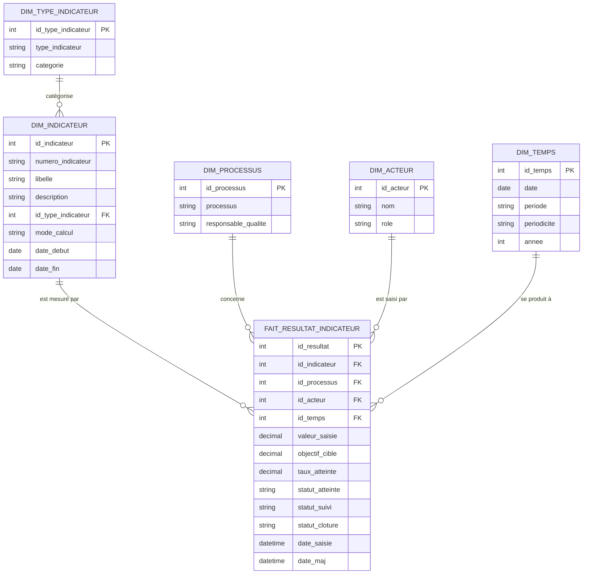

C'est une très bonne façon de procéder — et c'est même **la bonne pratique** : partir d'un schéma en étoile/flocon *cible* à partir de la base existante, puis l'ajuster quand le modèle réel sera figé. Tu ne perds pas de temps, tu prépares le terrain.

Voici comment formuler ça dans ta spec, pour que le relecteur comprenne que c'est **volontairement provisoire** :

---

**Paragraphe proposé (section « modèle de données ») :**

> Le modèle de données du *data warehouse* est conçu selon une approche en étoile (ou en flocon pour les dimensions les plus détaillées), à partir de la base opérationnelle existante. Il s'organise autour d'une ou plusieurs tables de faits (portant les mesures et les clés étrangères vers les dimensions) et de tables de dimensions (portant les attributs descriptifs, avec historisation SCD2 pour les dimensions à évolution lente). Ce schéma est **provisoire** : il sera affiné et aligné sur le modèle de données définitif du projet lorsqu'il sera disponible, sans remettre en cause l'architecture globale (staging → DWH → data marts). **Point d'attention** : les choix de granularité des faits et de historisation des dimensions doivent être validés avec le modèle définitif ; en attendant, le schéma cible sert de base de travail pour le développement et les tests.

---

**Ce que ça dit au relecteur :**
- Tu as une **démarche** (étoile/flocon à partir de l'existant) → c'est pro.
- Tu sais que c'est **provisoire** → pas de fausse promesse.
- Tu montres que l'**architecture globale ne bougera pas** → rassurant.
- Tu identifies le **vrai risque** (granularité + historisation à valider) → lucide.

**Conseil pratique pour ton schéma en attendant :**
- Commence par lister les **dimensions** probables (client, produit, temps, etc.) et les **faits** probables (ventes, commandes, mouvements de stock…).
- Pour chaque dimension, note les attributs **suivis** (ceux qui déclenchent un SCD2) — ça te servira directement pour le diagramme SCD2 que tu viens de documenter.
- Pour chaque fait, note la **granularité** (une ligne = quoi ?) et les **mesures** (montants, quantités…).
- Garde ça dans un tableau simple ; tu le remplaceras quand le vrai modèle arrivera.

---

**Bilan de ta journée :** tu as maintenant **8 paragraphes de diagrammes + 1 paragraphe de modèle de données**. C'est largement suffisant pour clôturer le document et le faire valider. Le reste (recherches complémentaires) peut attendre ou être cadré en 20-30 min si tu veux finir proprement.

Tu veux qu'on cadre les **recherches complémentaires** (2-3 questions précises max) pour boucler, ou tu considères que le document est assez complet pour être envoyé en validation ?

Parfait, avec cette base je peux te proposer un **schéma en étoile** directement exploitable. C'est un cas d'école : deux entités centrales (indicateur + résultat) et des axes d'analyse clairs.

---

## Schéma en étoile proposé

**Table de faits : `fait_resultat_indicateur`** (une ligne = une saisie de résultat pour un indicateur sur une période)

| Colonne | Rôle |
|---|---|
| `id_resultat` (PK) | identifiant |
| `id_indicateur` (FK) | → `dim_indicateur` |
| `id_temps` (FK) | → `dim_temps` (période de suivi) |
| `id_processus` (FK) | → `dim_processus` |
| `id_pilote` (FK) | → `dim_acteur` |
| `valeur_saisie` | mesure |
| `objectif_cible` | mesure (dégénérée ou portée par la dim selon choix) |
| `taux_atteinte` | mesure calculée |
| `statut_atteinte` | attribut dégénéré (ou → `dim_statut`) |
| `statut_suivi`, `statut_cloture` | attributs dégénérés |
| `date_saisie`, `date_maj` | → `dim_temps` (rôle saisie) |

**Dimensions :**

| Dimension | Attributs |
|---|---|
| `dim_indicateur` | n° indicateur, libellé, description, type indicateur, catégorie, mode de calcul, date début, date fin |
| `dim_processus` | processus, responsable qualité |
| `dim_acteur` | pilote processus, responsable qualité, auteur de saisie (rôles) |
| `dim_temps` | période (mois/trimestre/semestre/année), date, libellé période |
| `dim_statut` (optionnelle) | statut d'atteinte, statut de suivi, statut de clôture — utile si tu veux filtrer/agréger proprement |

**Pourquoi ce découpage :**
- **Le fait** porte les mesures (valeur, objectif, taux) + les clés vers les axes d'analyse.
- **`dim_indicateur`** porte le paramétrage (stable, historisable en SCD2 si le paramétrage change).
- **`dim_processus`** et **`dim_acteur`** sont les axes de reporting (les règles de gestion parlent de « processus », « pilote », « droits d'accès »).
- **`dim_temps`** gère la périodicité (mensuelle/trimestrielle/…) : une seule dimension temps, avec un niveau « période » — pas besoin d'une dimension par périodicité.
- **Les statuts** peuvent rester des attributs du fait (simplissime) ou devenir une petite dimension si tu veux des libellés/filtres propres.

**Flocon (si tu veux pousser) :** `dim_indicateur` → `dim_type_indicateur` (type → catégorie) et `dim_indicateur` → `dim_processus`. C'est le seul endroit où un flocon se justifie ici.

**Lien avec ta RLS :** la règle « les données affichées correspondent aux droits de l'utilisateur » se traduit par un filtre RLS sur `dim_processus` (ou `dim_acteur`) selon le périmètre de l'utilisateur — cohérent avec ce qu'on a dit sur la RLS côté Power BI.

---

**Paragraphe pour ta spec (à mettre à la place de mon paragraphe provisoire) :**

> Le modèle du data warehouse est organisé en étoile autour de la table de faits `fait_resultat_indicateur`, qui enregistre chaque saisie de résultat (valeur mesurée, objectif cible, taux d'atteinte) pour un indicateur et une période donnés. Elle est reliée aux dimensions `dim_indicateur` (paramétrage : libellé, type, catégorie, mode de calcul), `dim_processus` (processus, responsable qualité), `dim_acteur` (pilote, auteur de saisie) et `dim_temps` (période de suivi, dates). Les statuts (atteinte, suivi, clôture) sont portés par le fait comme attributs dégénérés, et peuvent être regroupés dans une dimension dédiée si les besoins de filtrage le justifient. Ce schéma reste provisoire et sera aligné sur le modèle de données définitif ; il sert de base au développement et aux tests. **Point d'attention** : la granularité du fait (une ligne par indicateur × période) et le périmètre de la RLS (filtrage par processus/acteur) doivent être validés avec le modèle définitif.

---

Tu veux que je te fasse le **diagramme textuel** (type Mermaid ou ASCII) du schéma en étoile pour l'insérer dans le document, ou tu préfères le dessiner toi-même dans ton outil ?

Voici la section remplie, prête à coller. J'ai gardé ta structure exacte et complété chaque point.

---

### 7.1 Schéma de données

Le Data Warehouse est organisé en trois schémas PostgreSQL distincts correspondant aux trois couches de la chaîne data :

- **`staging`** : données brutes extraites d'Odoo, sans transformation (zone d'atterrissage)
- **`dwh`** : modèle en étoile (tables de faits + dimensions)
- **`dm`** : data marts agrégés, prêts pour Power BI

#### 7.1.1 Modèle en étoile (schéma `dwh`)

Le schéma `dwh` s'organise en étoile autour de la table de faits `fait_resultat_indicateur`.

**Table des faits — `fait_resultat_indicateur`** (une ligne = une saisie de résultat pour un indicateur sur une période) :

| Colonne | Type | Rôle |
|---|---|---|
| `id_resultat` | int PK | Identifiant |
| `id_indicateur` | int FK | → `dim_indicateur` |
| `id_processus` | int FK | → `dim_processus` |
| `id_acteur` | int FK | → `dim_acteur` (auteur de saisie) |
| `id_temps` | int FK | → `dim_temps` (période de suivi) |
| `valeur_saisie` | decimal | Mesure |
| `objectif_cible` | decimal | Mesure |
| `taux_atteinte` | decimal | Mesure calculée |
| `statut_atteinte` | varchar | Attribut dégénéré |
| `statut_suivi` | varchar | Attribut dégénéré |
| `statut_cloture` | varchar | Attribut dégénéré |
| `date_saisie` | timestamp | Date de saisie |
| `date_maj` | timestamp | Date de dernière mise à jour |

**Dimensions :**

| Dimension | Attributs |
|---|---|
| `dim_indicateur` | `id_indicateur` (PK), `numero_indicateur`, `libelle`, `description`, `id_type_indicateur` (FK), `mode_calcul`, `date_debut`, `date_fin` |
| `dim_type_indicateur` | `id_type_indicateur` (PK), `type_indicateur`, `categorie` |
| `dim_processus` | `id_processus` (PK), `processus`, `responsable_qualite` |
| `dim_acteur` | `id_acteur` (PK), `nom`, `role` |
| `dim_temps` | `id_temps` (PK), `date`, `periode`, `periodicite`, `annee` |

Le flocon (`dim_indicateur` → `dim_type_indicateur`) porte la relation « type indicateur → catégorie ». Les statuts sont conservés comme attributs dégénérés du fait (pas de dimension dédiée) pour rester simple ; ils pourront être extraits dans une `dim_statut` si les besoins de filtrage le justifient.

#### 7.1.2 Schéma `staging`

Le schéma `staging` contient une copie brute des tables Odoo extraites, avec les mêmes colonnes que la source + trois colonnes techniques :

| Colonne technique | Type | Rôle |
|---|---|---|
| `_ingested_at` | timestamp | Horodatage de l'insertion dans le staging |
| `_source_table` | varchar | Nom de la table Odoo d'origine |
| `_batch_id` | varchar | Identifiant du run d'extraction (traçabilité / reprise) |

Ces colonnes permettent de tracer l'origine de chaque ligne, de relancer un batch en cas d'erreur et de faciliter le diagnostic qualité.

#### 7.1.3 Schéma `dm` (data marts)

Le schéma `dm` contient les agrégats prêts pour Power BI, reconstruits en full refresh (`TRUNCATE` + `INSERT`) à chaque run du DAG `datamarts` :

| Data mart | Granularité | Contenu |
|---|---|---|
| `dm.synthese_indicateur` | indicateur × période | Valeur, objectif, taux d'atteinte, statuts |
| `dm.synthese_processus` | processus × période | Nombre d'indicateurs atteints / non atteints / suivis / clôturés, taux moyen d'atteinte |
| `dm.evolution_temporelle` | indicateur × période (série) | Tendance et historique pour les graphiques |

Ces marts couvrent les besoins de reporting : tableaux de bord, graphiques, tendances et historiques, avec filtrage par processus, période, statut d'atteinte, statut de suivi et statut de clôture.

#### 7.1.4 ERD simplifié



---

### 7.2 Requêtes principales

**Chargement (staging ← Odoo)**

```sql
-- Extraction incrémentale : seules les lignes modifiées depuis le dernier watermark
INSERT INTO staging.resultat_indicateur (_ingested_at, _source_table, _batch_id, ...)
SELECT now(), 'resultat_indicateur', :batch_id, r.*
FROM odoo_replica.resultat_indicateur r
WHERE r.write_date > (SELECT watermark FROM dwh.table_controle WHERE nom_job = 'extract_resultat');
```

**Mise à jour SCD2 (dwh ← staging)**

```sql
-- 1) Clôture de la version courante si un attribut suivi a changé
UPDATE dwh.dim_indicateur d
SET valid_to = now(), is_current = false
FROM staging.indicateur s
WHERE d.id_indicateur = s.id
  AND d.is_current = true
  AND (d.libelle, d.mode_calcul, d.id_type_indicateur) IS DISTINCT FROM (s.libelle, s.mode_calcul, s.id_type_indicateur);

-- 2) Insertion de la nouvelle version courante
INSERT INTO dwh.dim_indicateur (id_indicateur, libelle, mode_calcul, id_type_indicateur, valid_from, valid_to, is_current)
SELECT s.id, s.libelle, s.mode_calcul, s.id_type_indicateur, now(), NULL, true
FROM staging.indicateur s
WHERE NOT EXISTS (
    SELECT 1 FROM dwh.dim_indicateur d
    WHERE d.id_indicateur = s.id AND d.is_current = true
);
```

**Alimentation d'un data mart (dm ← dwh)**

- **Tables impactées** : `dm.synthese_processus` (lecture de `fait_resultat_indicateur`, `dim_processus`, `dim_temps`)
- **Logique** :
```sql
TRUNCATE dm.synthese_processus;
INSERT INTO dm.synthese_processus (processus, periode, nb_atteints, nb_non_atteints, nb_suivis, nb_clotures, taux_moyen)
SELECT p.processus, t.periode,
       count(*) FILTER (WHERE f.statut_atteinte = 'atteint'),
       count(*) FILTER (WHERE f.statut_atteinte = 'non_atteint'),
       count(*) FILTER (WHERE f.statut_suivi = 'suivi'),
       count(*) FILTER (WHERE f.statut_cloture = 'cloture'),
       avg(f.taux_atteinte)
FROM dwh.fait_resultat_indicateur f
JOIN dwh.dim_processus p ON p.id_processus = f.id_processus
JOIN dwh.dim_temps t ON t.id_temps = f.id_temps
GROUP BY p.processus, t.periode;
```

---

### 7.3 Optimisation

#### 7.3.1 Indexation

- **Index sur les clés étrangères** (indispensables pour les jointures) :
```sql
CREATE INDEX idx_fait_indicateur ON dwh.fait_resultat_indicateur (id_indicateur);
CREATE INDEX idx_fait_processus ON dwh.fait_resultat_indicateur (id_processus);
CREATE INDEX idx_fait_acteur ON dwh.fait_resultat_indicateur (id_acteur);
CREATE INDEX idx_fait_temps ON dwh.fait_resultat_indicateur (id_temps);
```

- **Index sur les colonnes de filtre** (utilisées par Power BI) :
```sql
CREATE INDEX idx_fait_statut_atteinte ON dwh.fait_resultat_indicateur (statut_atteinte);
CREATE INDEX idx_fait_statut_suivi ON dwh.fait_resultat_indicateur (statut_suivi);
CREATE INDEX idx_fait_statut_cloture ON dwh.fait_resultat_indicateur (statut_cloture);
CREATE INDEX idx_temps_periode ON dwh.dim_temps (periode);
```

- **Index partiel sur SCD2** (garantit l'unicité de la version courante) :
```sql
CREATE UNIQUE INDEX idx_dim_indicateur_current ON dwh.dim_indicateur (id_indicateur) WHERE is_current = true;
CREATE UNIQUE INDEX idx_dim_processus_current ON dwh.dim_processus (id_processus) WHERE is_current = true;
```

- **Index sur les clés métier** (pour les lookups ETL) :
```sql
CREATE INDEX idx_staging_indicateur_numero ON staging.indicateur (numero_indicateur);
CREATE INDEX idx_dim_indicateur_numero ON dwh.dim_indicateur (numero_indicateur);
```

---

**Deux remarques pour que le document soit cohérent :**

1. **SCD2 et `dim_indicateur`** : dans l'ERD, `dim_indicateur` n'a pas encore `valid_from` / `valid_to` / `is_current`. Si tu appliques le SCD2 (ce que le diagramme SCD2 décrit), il faut ajouter ces trois colonnes à la dimension concernée. Dis-moi si le SCD2 porte sur `dim_indicateur`, `dim_processus` ou les deux, et j'aligne l'ERD et les requêtes.
2. **`date_saisie` / `date_maj`** dans le fait : ce sont des dates, pas des FK vers `dim_temps`. C'est volontaire (rôle « date de saisie » distinct de la période de suivi) — mais si tu veux un rôle temporel propre pour Power BI, on peut ajouter une seconde FK `id_temps_saisie` vers `dim_temps`. Tu préfères garder simple ou ajouter le rôle ?

Tu veux que je te génère aussi le **script DDL complet** (CREATE SCHEMA + CREATE TABLE) pour la section, ou ça suffit comme ça ?